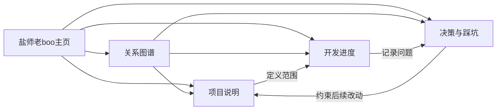
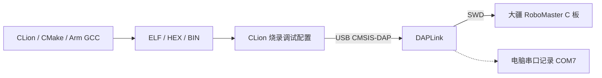
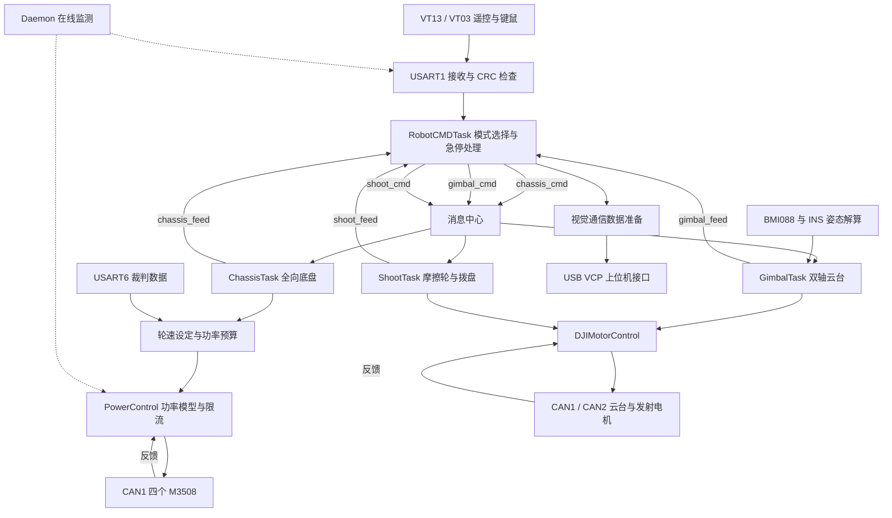
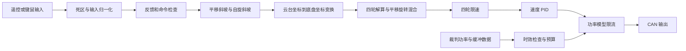

<a id="top"></a>

# 盐师老boo｜项目开发手册

基于湖南大学 RoboMaster 跃鹿战队 basic_framework 修改的全向轮机器人电控项目。

本文合并项目说明、开发进度、决策与踩坑、关系图谱四篇 Obsidian 笔记，并将原主页目录改为本文件内的子级 TOC。目录和交叉引用均可在 GitHub 中直接跳转，Mermaid 图保留在文中。

- 更新日期：2026-11-17。
- 当前维护分支：`Infantry_bai`。
- 固件源码来源：`Omni_graduation_design_27new_Sentinel`，已验证源码提交 `f00e4fe`。
- 当前进展：依赖已补齐，增量编译通过；用户提供的 OpenOCD 日志显示烧录写入完成，待记录本轮实车验收结果。
- 开发环境：CLion 2026.1、大疆 RoboMaster C 板、CMSIS-DAPv2 / Horco v0.2、SWD。

## 目录

- [项目说明](#project)
  - [目标](#project-1)
  - [版本与位置](#project-2)
  - [主要功能](#project-3)
    - [功能边界](#project-4)
  - [技术栈](#project-5)
  - [软件结构](#project-6)
  - [当前参数与接线映射](#project-7)
    - [操作速查](#project-8)
  - [CLion 使用与版本维护](#project-9)
  - [依据](#project-10)
- [开发进度](#progress)
  - [当前状态](#progress-1)
  - [CLion 开发配置](#progress-2)
  - [2026-11-17 用户烧录记录](#progress-3)
  - [2026-11-17 构建通过记录](#progress-4)
  - [2026-11-17 构建失败记录](#progress-5)
    - [同日重试：1871f22](#progress-6)
  - [已有迭代记录](#progress-7)
  - [优先待办](#progress-8)
    - [P0：确保最佳版本可以重新构建](#progress-9)
    - [P1：建立可比较的实车记录](#progress-10)
    - [P2：根据需求决定](#progress-11)
  - [下一步](#progress-12)
  - [待用户补充](#progress-13)
  - [调试记录模板](#progress-14)
    - [YYYY-MM-DD｜本次调试主题](#progress-15)
- [决策与踩坑](#decisions)
  - [关键选择](#decisions-1)
  - [源码同步不等于可复现编译](#decisions-2)
  - [目录名与编译器实际版本](#decisions-3)
  - [遥控串口：板上丝印不等于外设编号](#decisions-4)
  - [DAPLink：COM7 与 SWD 的区别](#decisions-5)
  - [CMake 灰色预览与自定义选项](#decisions-6)
  - [云台方向与底盘方向不一致](#decisions-7)
  - [键鼠 W/S 反向与发射使能](#decisions-8)
  - [枚举名称不能代替实际行为](#decisions-9)
  - [小陀螺速度：估算值需要实测](#decisions-10)
  - [功率受限时的“跑不动”怎么区分](#decisions-11)
  - [卡弹恢复：检测与重试边界](#decisions-12)
  - [参数与注释的误读](#decisions-13)
  - [新增记录模板](#decisions-14)
    - [YYYY-MM-DD｜问题或选择](#decisions-15)
- [关系图谱](#graph)
  - [Obsidian 知识关系](#graph-1)
  - [控制与反馈关系](#graph-2)
    - [编译与下载连接](#graph-3)
    - [运行时数据流](#graph-4)
  - [底盘处理链](#graph-5)
  - [源码与笔记对照](#graph-6)
  - [维护方式](#graph-7)

<a id="project"></a>

## 项目说明

> [!NOTE]
> **盐师老boo**：基于湖南大学 RoboMaster 跃鹿战队 `basic_framework` 修改的全向轮机器人电控项目。用户于 2026-11-17 确认：这一份是目前调试效果最好的一版，使用 CLion 编译、烧录；实物为大疆 RoboMaster C 板，使用 DAPLink。


<a id="project-1"></a>

### 目标

1. 保存目前最好用的整车控制基线，让代码、参数、构建环境和调试结论可以追溯。
2. 实现遥控/键鼠输入到全向底盘、双轴云台、发射机构的完整控制。
3. 改善平移启停、小陀螺行进和受功率限制时的操控表现。
4. 保留异常停止、遥控离线处理与卡弹恢复，并通过后续实车记录验证效果。

<a id="project-2"></a>

### 版本与位置

| 项目 | 当前记录 |
| --- | --- |
| 本地代码 | `D:\1CLiongithub\basic_framework` |
| GitHub | [devb00ker/basic_framework](https://github.com/devb00ker/basic_framework/tree/Omni_graduation_design_27new_Sentinel) |
| 当前维护分支 | `Infantry_bai` |
| 源码来源分支 | `Omni_graduation_design_27new_Sentinel` |
| 已验证固件源码提交 | `f00e4feb81f2b157b50d6ebeffe3ea1a9daafda3`，2026-11-17 已确认与远程同步 |
| 固件源码提交说明 | 补充文件 |
| 原调试基线 | `0dc76aa6d487438edd96fa6a56710a7ea9ee47fb`，2026-11-01；行进小陀螺优先保留平移、完善功率管理、增加调参观察量 |
| 文档目录 | `D:\obsidian_file\dev\盐师老boo` |

2026-11-17 固件源码已验证到 `f00e4fe`：此前 `c99de52` 修改拨盘方向，`1871f22` 补回两个底盘辅助头文件，`f00e4fe` 补回 `modules/motor/power_limit_math.h`。三个依赖现已齐全，增量编译、链接和 ELF/HEX/BIN 生成通过；用户提供的日志显示同一路径 ELF 已烧录写入完成，实车运行结果待记录。当前项目在 `Infantry_bai` 分支维护。

> [!IMPORTANT]
> “当前最佳”来自用户对之前调试效果的结论。当前 `f00e4fe` 已补齐三个依赖并编译链接通过；用户日志显示烧录写入完成，未提供显式读回校验及本轮实车验收结果。详见 [2026-11-17 用户烧录记录](#progress-3)。

<a id="project-3"></a>

### 主要功能

| 模块 | 当前代码表现 | 主要入口 |
| --- | --- | --- |
| 操作输入 | VT13/VT03 图传遥控适配；遥控、键鼠、急停模式；CRC 检查与在线检测 | `modules/remote/remote_control.c`、`application/cmd/robot_cmd.c` |
| 全向底盘 | 四轮解算、按云台方向变换平移指令、摇杆死区、斜向归一化、加减速斜坡、小陀螺切换斜坡、轮速限制 | `application/chassis/chassis.c` |
| 行进小陀螺 | 调用平移与旋转混合分配函数，提交说明明确优先保留平移；辅助算法与调参头文件已取回，具体行为待后续验收 | `ChassisMixWheels()` 调用处 |
| 功率管理 | 裁判数据时效检查、功率预算、失效回退、功率模型限流、反馈异常处理和观察量 | `modules/motor/power_control.c`、`modules/referee/rm_referee.c` |
| 云台 | GM6020 yaw/pitch 双轴，IMU 姿态与角速度反馈，角度/速度闭环，pitch 软件限位 | `application/gimbal/gimbal.c` |
| 发射机构 | 双摩擦轮、拨盘、手动连发；连发堵转检测、反转恢复、重试后停盘 | `application/shoot/shoot.c` |
| 任务与监测 | FreeRTOS 调度、消息发布订阅、Daemon 在线监测、调试观察结构体 | `application/robot_task.h`、`modules/message_center/` |
| 视觉通信 | 保留 USB VCP 通信和数据发送接口；当前手动控制路径禁用自瞄 | `modules/master_machine/master_process.c` |

<a id="project-4"></a>

#### 功能边界

- `CHASSIS_FOLLOW_GIMBAL_YAW` 当前设置旋转指令为零，实际保留按枪口方向平移的行为，没有新增自动旋转追随云台。
- 弹舱盖开关代码仍为空实现；不能写成已完成舱盖控制。
- 存在超级电容模块不等于当前整车已接入电容管理。当前 `ChassisInit()` 没有初始化电容；Shift 只是放大输入，仍受后续限幅影响。
- 枚举包含单发、三连发和自瞄等模式，但当前人工操作入口主要使用手动连发，不能把全部枚举都算成已验收功能。
- 当前裁判热量反馈相关赋值有注释，不能据此宣称已完成热量管理或满足赛事限制。

<a id="project-5"></a>

### 技术栈

| 层级 | 技术与依据 |
| --- | --- |
| 主控板 / MCU | 用户确认大疆 RoboMaster C 板；工程目标为 STM32F407IG / Cortex-M4F，链接脚本为 `STM32F407IGHx_FLASH.ld` |
| 语言 | C11 与启动汇编 |
| IDE | CLion 2026.1，用户确认用于编译和烧录 |
| 构建 | CMake + Ninja；当前 CMake 配置为 Debug，`-Og -g -gdwarf-2` |
| 编译器 | 实测 Arm GNU Toolchain 13.3.Rel1 / GCC 13.3.1；程序仍位于 `C:/CLionToolchains/gcc-arm-none-eabi-10.3-2021.10/bin/arm-none-eabi-gcc.exe`，目录名不是实际版本 |
| 底层 | STM32 HAL、CMSIS、CMSIS-DSP、STM32CubeMX `.ioc` |
| 实时系统 | FreeRTOS / CMSIS-OS |
| 控制与感知 | PID、BMI088 IMU、姿态解算、运动学、功率模型 |
| 通信 | CAN、UART、USB VCP；硬件支持层另含 SPI、I²C 等 |
| 烧录调试 | 探针报告 Horco v0.2、CMSIS-DAPv2；SWD 2000 kHz；OpenOCD 0.12.0，实际加载 `openocd_dap.cfg` 烧录 ELF |
| 版本与知识管理 | Git / GitHub、Obsidian Markdown / 双向链接 / Mermaid |

<a id="project-6"></a>

### 软件结构

`application` 负责机器人行为，`modules` 提供电机、算法和设备模块，`bsp` 封装硬件接口，底层为 HAL 与 MCU。

应用间通过消息中心连接：CMD 发布 `chassis_cmd`、`gimbal_cmd`、`shoot_cmd`；各应用返回对应的 `*_feed`。`RobotTask()` 中调用顺序是 CMD → Shoot → Chassis → Gimbal。

任务循环包含：INS 与电机任务 `osDelay(1)`、机器人任务 `osDelay(5)`、Daemon `osDelay(10)`。这些是代码设置的延时，并非此次实测的固定运行频率。

完整图示见 [控制与反馈关系](#graph-2)。

<a id="project-7"></a>

### 当前参数与接线映射

以下是源码配置，仍需和实物核对。电机 ID 指配置编号，不是完整 CAN 报文 ID。

用户确认的下载连接为：**电脑 USB → DAPLink → SWD 线 → 大疆 RoboMaster C 板**；电脑上看到的串口号为 **COM7**。COM7 是串口记录，DAPLink 的 SWD 烧录使用 CMSIS-DAP 调试接口，不需要仅因 COM 号变化修改 SWD 配置。

用户提供的芯片型号原文为 `stm32F407iHGHX`；当前工程文件使用 `STM32F407IGHx` 命名。完整料号尚待按芯片丝印核对，此处保留两者来源，不擅自修改工程目标。

| 对象 | 配置 |
| --- | --- |
| 控制板拓扑 | `ONE_BOARD`，单板整车控制 |
| 底盘电机 | M3508；CAN1；LF=1、RF=2、LB=4、RB=3 |
| 云台 yaw | GM6020；CAN1；ID=3 |
| 云台 pitch | GM6020；CAN2；ID=6 |
| 左/右摩擦轮 | M3508；CAN2；ID=5 / 6 |
| 拨盘 | M2006；CAN2；ID=7 |
| 遥控串口 | `huart1` / USART1，921600；代码注释对应 C 板丝印 UART2 |
| 裁判串口 | `huart6` / USART6，115200 |
| 视觉链路 | `VISION_USE_VCP`，USB 虚拟串口 |
| 轴距 / 轮距 | 379 / 450 mm |
| 轮半径 / 减速比 | 77.5 mm / 19 |
| 云台标定 | yaw 对齐编码器 1317；pitch 水平编码器 2685 |
| pitch 软件限位 | −30° ～ +30° |

不同电机协议的编号和报文映射不同，不能只比较表中数字就判定 CAN 冲突。

<a id="project-8"></a>

#### 操作速查

| 输入 | 当前行为 |
| --- | --- |
| C 挡 / 暂停键 / 遥控离线 | 急停处理 |
| N 挡 | 摇杆控制：左摇杆底盘，右摇杆云台 |
| N 挡拨轮绝对值大于 400 | 小陀螺 |
| N 挡左自定义键 + 扳机 | 按住左自定义键开启摩擦轮，同时按住扳机连发 |
| S 挡 | 键鼠控制 |
| WASD / 鼠标移动 | 底盘平移 / 云台调整 |
| Q | 按下切换小陀螺 |
| F / 鼠标左键 | F 切换摩擦轮；摩擦轮开启时按住左键连发 |
| 鼠标右键 | 当前不接管自瞄 |

<a id="project-9"></a>

### CLion 使用与版本维护

1. 打开 `D:\1CLiongithub\basic_framework`，确认分支和提交。
2. 使用现有 Arm 工具链与 Debug CMake 配置；缓存中的构建目录为 `cmake-build-debug`。
3. 先核对 [优先待办](#progress-8) 中的源码完整性，再 Build。预期输出是 `basic_framework.elf`、`.hex`、`.bin`。
4. 使用已有 CLion 烧录配置。用户日志已确认实际使用仓库 `openocd_dap.cfg`（CMSIS-DAP、SWD、STM32F4），下载 `cmake-build-debug/basic_framework.elf`，随后 reset、shutdown。
5. 每次调参保留提交号、参数改动、测试工况和结果，更新 [开发进度](#progress)；原因与经验记录到 [决策与踩坑](#decisions)。

详细环境表见 [CLion 开发配置](#progress-2)。CMake 自定义选项为空，保留 Debug、默认 MinGW/Ninja 和 `-j 18` 即为当前配置；灰色文字为默认生成参数预览。OpenOCD 实际下载路径和复位顺序已由日志核实。

<a id="project-10"></a>

### 依据

项目说明以当前源码、`CMakeLists.txt`、`cmake-build-debug/CMakeCache.txt`、Git 记录和用户描述为依据。上游框架资料用于背景参考，不直接作为本车功能验收依据；框架说明保留在 `.Doc/` 及各模块文档中。

<a id="progress"></a>

## 开发进度


<a id="progress-1"></a>

### 当前状态

**当前处于“编译通过、已有烧录完成日志，等待实车验收记录”的阶段。** 已同步到 `f00e4fe`，三个缺失头文件全部补回。2026-11-17 增量编译、链接和 HEX/BIN 生成通过；用户随后提供的 OpenOCD 日志显示同一路径 ELF 已写入完成。尚无本页记录的本轮整车实测结果。

| 项目          | 状态        | 说明                                                  |
| ----------- | --------- | --------------------------------------------------- |
| 版本基线        | 已确认       | `Omni_graduation_design_27new_Sentinel` / `0dc76aa` |
| 固件源码基线 | 已验证 | `f00e4fe`；在此代码基础上创建 `Infantry_bai` 维护分支 |
| CLion 开发方式 | 主要构建与烧录参数已确认 | CLion 2026.1；CMSIS-DAPv2 经 SWD；配置文件和 ELF 路径已由日志核实 |
| 基础控制        | 代码已实现     | 遥控、键鼠、底盘、云台、手动连发                                    |
| 底盘调优 | 代码与依赖已齐 | 加减速、小陀螺混合、轮速限制、功率预算；当前已编译通过，实车效果待记录 |
| 卡弹处理        | 已有状态机     | 连发堵转恢复；尚无本页记录的重复实测数据                                |
| 自瞄          | 当前禁用      | 通信接口保留                                              |
| 项目文档 | 已合并 | 原四篇笔记与主页目录合并为仓库根目录 `README.md` |
| 当前目录构建 | 通过，有链接警告 | 增量构建退出码 0，生成 ELF/HEX/BIN；不是干净环境重建验收 |
| 用户烧录日志 | 写入完成 | 输出 `Programming Finished`；命令随后为 reset、shutdown；没有显式读回校验记录 |

<a id="progress-2"></a>

### CLion 开发配置

依据：2026-11-17 用户提供的工具链、OpenOCD 与 CMake 截图、输入框说明、实际烧录命令与日志，以及本项目现有 `CMakeCache.txt`。

| 配置项               | 当前记录                                                                                                | 依据                                                                          |
| ----------------- | --------------------------------------------------------------------------------------------------- | --------------------------------------------------------------------------- |
| CLion 版本          | `2026.1`                                                                                            | 用户确认；未记录具体 Build 编号                                                         |
| 工具链名称             | `MinGW`                                                                                             | 截图                                                                          |
| 工具集目录             | `C:\CLionToolchains\mingw64`，界面版本 `6.0 w64`                                                         | 截图                                                                          |
| CMake             | CLion 捆绑版本 `4.2.2`                                                                                  | 截图                                                                          |
| CMake 程序          | `D:\CLion 2026.1\bin\cmake\win\x64\bin\cmake.exe`                                                   | 构建缓存                                                                        |
| 构建工具              | Ninja；`D:\CLion 2026.1\bin\ninja\win\x64\ninja.exe`                                                 | 截图和构建缓存                                                                     |
| C 编译器             | `C:\CLionToolchains\gcc-arm-none-eabi-10.3-2021.10\bin\arm-none-eabi-gcc.exe`                       | 截图与构建缓存核对                                                                   |
| C 编译器实际版本         | Arm GNU Toolchain `13.3.Rel1`，GCC `13.3.1 20240614`                                                 | 2026-11-17 执行上述程序 `--version`；目录名中的 10.3 不能代表实际版本                           |
| C++ 编译器           | `C:\CLionToolchains\gcc-arm-none-eabi-10.3-2021.10\bin\arm-none-eabi-g++.exe`                       | 截图和构建缓存；本工程构建语言为 C / ASM                                                    |
| 调试器               | 捆绑的 GDB，界面版本 `16.3`                                                                                 | 截图；具体运行配置是否覆盖此选择待确认                                                         |
| OpenOCD 程序 / 版本   | `C:\CLionToolchains\OpenOCD-20231002-0.12.0\bin\openocd.exe`；`0.12.0 (2023-10-02)`，sysprogs 发行构建    | 路径来自截图和烧录命令；版本来自实际烧录输出                                                      |
| CMake 配置名称 / 启用状态 | `Debug`，已启用；“共享”未勾选                                                                                 | CMake 截图                                                                    |
| 构建类型              | `Debug`                                                                                             | CMake 截图、构建缓存与 `CMakeLists.txt`                                             |
| 配置使用的工具链 / 生成器    | 使用默认值 `MinGW` / 使用默认值 `Ninja`                                                                       | CMake 截图                                                                    |
| CMake 选项（自定义输入）   | 空，无额外自定义选项；外面的灰色内容为生成参数的默认预览                                                                        | 用户确认点击输入框为空；Debug、Ninja 等参数由对应界面设置生成，无需复制回填                                 |
| 构建目录              | 界面为 `cmake-build-debug`；对应 `D:\1CLiongithub\basic_framework\cmake-build-debug`                      | CMake 截图与构建缓存                                                               |
| 构建选项              | `-j 18`，并行构建数为 18                                                                                   | CMake 截图                                                                    |
| 构建与下载目标           | `basic_framework.elf`；烧录路径为 `D:/1CLiongithub/basic_framework/cmake-build-debug/basic_framework.elf` | 构建日志及实际烧录命令                                                                 |
| 环境                | 环境输入栏未显示自定义内容；仍可能继承系统或工具链环境                                                                         | CMake 截图                                                                    |
| 编辑 CMake 文件时重新加载  | 该复选框未勾选；界面提示外部变更（如 VCS 更新）仍会触发重载                                                                    | CMake 截图                                                                    |
| 烧录硬件              | 电脑 USB → DAPLink → SWD → 大疆 RoboMaster C 板                                                          | 用户确认                                                                        |
| 探针报告的固件版本         | `Horco v0.2`                                                                                        | OpenOCD 输出 `CMSIS-DAP: FW Version = Horco v0.2`；保留原报告名称，不当作官方 DAPLink 发布版本号 |
| 探针接口 / SWD 时钟     | CMSIS-DAPv2；2000 kHz                                                                                | 实际烧录输出                                                                      |
| OpenOCD 配置文件      | `D:\1CLiongithub\basic_framework\openocd_dap.cfg`                                                   | 实际命令的 `-f` 参数                                                               |
| OpenOCD 脚本目录      | `C:\CLionToolchains\OpenOCD-20231002-0.12.0\share\openocd\scripts`                                  | 实际命令的 `-s` 参数                                                               |
| 串口记录              | `COM7`；SWD 下载使用 CMSIS-DAP 接口                                                                        | 用户确认和接口说明                                                                   |

工具链名称虽然是 `MinGW`，本工程实际 C 编译器是 `arm-none-eabi-gcc`。工具集目录、构建工具与目标编译器是不同配置项，复现时应分别核对。

烧录所用 ELF、OpenOCD 配置文件和命令已通过实际输出确认。CLion 配置的界面名称、类型和单独的调试会话设置尚未提供，但已不影响记录当前烧录流程。

CMake 配置页面已补录。用户进一步确认“CMake 选项”点击后为空，因此更正此前“完整选项文本待补录”的记录：这里没有额外自定义文本，灰色为默认参数预览。保留当前设置即可，不需要填入这段预览。“构建选项”的 `-j 18` 是另一个字段，已单独记录。

固件信息已由实际烧录日志取得：`Horco v0.2`。没有 `DETAILS.TXT` 不影响本次记录；不把 CMSIS-DAPv2 协议名称或 Windows 驱动版本混作探针固件版本。

<a id="progress-3"></a>

### 2026-11-17 用户烧录记录

用户提供的实际命令确认以下顺序：启动上述 OpenOCD → 加载 `openocd_dap.cfg` → 关闭 TCL/GDB 服务端口 → `program` 指定 ELF → `reset` → `shutdown`。命令中 `tcl_port disabled` 重复出现一次，日志没有因此报错。

关键输出摘录：

```text
Open On-Chip Debugger 0.12.0 (2023-10-02)
Using CMSIS-DAPv2 interface with VID:PID=0xfaed:0x4870
CMSIS-DAP: FW Version = Horco v0.2
CMSIS-DAP: Interface Initialised (SWD)
clock speed 2000 kHz
[stm32f4x.cpu] Cortex-M4 r0p1 processor detected
device id = 0x10076413
flash size = 1024 KiB
** Programming Started **
** Programming Finished **
shutdown command invoked
```

结论：探针和目标芯片连接成功，OpenOCD 报告写入完成。该命令没有 `verify`，日志也没有显式读回校验结果；本页记录为“烧录写入完成”，不写成“读回校验通过”或“整车功能通过”。

<a id="progress-4"></a>

### 2026-11-17 构建通过记录

- 提交：`f00e4feb81f2b157b50d6ebeffe3ea1a9daafda3`，本地与远程一致。
- 新增文件：`modules/motor/power_limit_math.h`，三个原缺失依赖现均已加入 Git。
- 验证方式：使用上表 Arm GCC、CMake/Ninja 与现有 `cmake-build-debug`，执行 `--target basic_framework.elf -j 18`；终端本次将编译器 `bin` 加入当前进程 PATH，便于调用配套 objcopy/size，未改变系统环境变量。
- 结果：增量编译、链接和后处理通过，退出码 0；未执行 clean rebuild，未烧录。
- 日志：f00e4fe 构建通过日志（历史日志未包含在合并文件中，本节保留结果摘要）。

| 输出（均在源码根目录的 `cmake-build-debug` 中） | 文件大小 |
| --- | --- |
| `basic_framework.elf` | 1,244,160 B，含调试信息 |
| `basic_framework.hex` | 286,320 B |
| `basic_framework.bin` | 101,768 B |

链接器报告 RAM 使用 78,904 B / 128 KB（60.20%），FLASH 使用 101,768 B / 1 MB（9.71%），CCMRAM 使用 0 B。这是链接阶段的静态内存统计，不是实测任务栈或运行峰值。

仍有 newlib/nosys 的 `_close`、`_lseek`、`_read`、`_write` 未实现警告；没有阻止构建。若以后依赖这些标准输入输出/文件接口，需要检查是否提供相应实现；本次未修改相关代码。相关说明见 [目录名与编译器实际版本](#decisions-3)。

<a id="progress-5"></a>

### 2026-11-17 构建失败记录

原始日志：CLion 构建输出（历史日志未包含在合并文件中，本节保留结果摘要）。

```powershell
& "D:\CLion 2026.1\bin\cmake\win\x64\bin\cmake.exe" --build D:\1CLiongithub\basic_framework\cmake-build-debug --target basic_framework.elf -j 18
```

- 失败位置：`application/cmd/robot_cmd.c:13`、`application/chassis/chassis.c:25`。
- 直接错误：`fatal error: chassis_math.h: No such file or directory`。
- CMake/Ninja 已调起 Arm GCC，日志包含多个成功编译步骤；当前失败发生在源码编译阶段，日志未涉及 OpenOCD、DAPLink 或 COM7。
- `robot.c` 与 `bmi088.c` 的 `#pragma message` 是配置提醒，不是这次构建中止的直接原因。
- 同时检查到 `chassis_tuning.h`、`power_limit_math.h` 也缺失；当前日志尚未直接报出这两个文件，补齐第一个后仍需核对它们。
- 初次恢复检查：当前仓库所有本地可见引用的文件历史、stash，以及已搜索的本地代码/备份目录均未发现三个原头文件。
- 后续远程同步：已获取并快进至 `c99de52`，新增提交只修改拨盘方向，远程文件清单仍无三个缺失头文件。因此拉取完成不等于编译依赖已补齐；仍需另一台电脑把原文件及相关实现提交到这个分支。此次同步后未重新构建或烧录。
- 用户已确认：此前成功编译、烧录使用的是**另一台电脑**。应优先从那台电脑的实际工程目录找回完整源码，核对三个头文件及相关实现是否未提交。
- 下一步：将另一台电脑的完整工程备份取回，先放入独立目录核对，恢复原实现与参数，然后重新构建。

<a id="progress-6"></a>

#### 同日重试：1871f22

- 当前本地与远程均为 `1871f22`，已补回 `application/chassis/chassis_math.h` 和 `application/chassis/chassis_tuning.h`。
- 已执行同一 CMake 构建命令，退出码 1。错误位置为 `modules/motor/power_control.c:6`、`application/chassis/chassis.c:27`，均缺少 `power_limit_math.h`。
- 重试日志：1871f22 构建输出（历史日志未包含在合并文件中，本节保留结果摘要）。
- 当前待办缩小为：在另一台电脑找到并提交 `power_limit_math.h` 及其相关实现，再推送到同一分支。
- CLion 的“仓库差异”绿色内容表示新增代码，是提交查看界面；它本身不表示合并冲突，也不需要手动把绿色内容复制到文件。

<a id="progress-7"></a>

### 已有迭代记录

按 Git 提交记录整理；“修复”表示提交说明和代码变更，不代表本次再次验收。

| 日期 | 提交 | 改动 |
| --- | --- | --- |
| 2026-10-20 | `c9d488c` | 遥控更新为 VT13、VT03 图传遥控 |
| 2026-10-24 | `2b17605` | 修正云台旋转与底盘前进逻辑方向不一致 |
| 2026-10-24 | `e1b7302` | 左杆底盘、右杆云台；调整 pitch 灵敏度和小陀螺目标 |
| 2026-10-27 | `c55daf9` | 修复键鼠 W/S 方向及无法发射；Q 改为按下切换 |
| 2026-10-27 | `a8b0353` | 增加临时软件卡弹恢复策略和重试停盘 |
| 2026-11-01 | `2e2dc4d` | 平移加减速、小陀螺切换斜坡、摇杆死区、斜向归一化、四轮同比例限速 |
| 2026-11-01 | `0dc76aa` | 行进小陀螺优先保留平移、完善功率管理、增加观察量 |
| 2026-11-17 | 文档整理 | 用户确认最佳版本，建立知识库并记录源码完整性问题 |
| 2026-11-17 | 同步 `c99de52` | 已快进更新；拨盘方向 REVERSE → NORMAL，三个依赖头文件仍缺失 |
| 2026-11-17 | 核对 `1871f22` 并重试构建 | 两个底盘头文件已补回；仍缺 `power_limit_math.h`，编译失败 |
| 2026-11-17 | 同步 `f00e4fe` 并构建 | 补回 `power_limit_math.h`；增量编译、链接、固件生成通过，未烧录 |
| 2026-11-17 | 用户提供烧录完成日志 | 核实 Horco v0.2、CMSIS-DAPv2、SWD 2000 kHz、配置文件与 ELF；待实车记录 |

<a id="progress-8"></a>

### 优先待办

<a id="progress-9"></a>

#### P0：确保最佳版本可以重新构建

- [x] 通过 `1871f22` 取回 `chassis_math.h`、`chassis_tuning.h`。
- [x] 通过 `f00e4fe` 取回并提交 `power_limit_math.h`。
- [x] 通过另一台电脑的推送取回三个原依赖文件，本机未重写相关算法或参数。
- [x] 使用 CLion 现有 CMake Debug 构建目录完成增量编译、链接和固件生成，保存成功日志。
- [x] 根据截图和缓存记录工具链、编译器、CMake/Ninja、GDB 界面版本及 OpenOCD 路径，见本页“CLion 开发配置”。
- [x] 补录 CMake Debug 配置：默认 MinGW/Ninja、构建目录、`-j 18` 和界面重载设置。
- [x] 补录用户确认的 CLion 版本 `2026.1`。
- [x] 确认 CMake 自定义选项为空，灰色为默认生成参数预览。
- [x] 记录实际烧录命令、配置文件、ELF 路径、OpenOCD 版本和探针固件字符串 `Horco v0.2`。
- [ ] 如需复现单独的调试会话，再补录 CLion 配置界面名称、类型和调试设置。
- [ ] 将验证通过的基线做 Git 标签或完整备份，确保包含构建依赖及参数。此项是建议，尚未创建标签或备份。

<a id="progress-10"></a>

#### P1：建立可比较的实车记录

- [x] 确认项目名“盐师老boo”、大疆 RoboMaster C 板及 DAPLink 的 USB → SWD 下载链路，电脑串口记录为 COM7。
- [ ] 补充车型/用途，核对芯片完整丝印、电机与传感器、接线和零位标定。
- [ ] 记录前后左右、斜向、不同云台朝向的实际运动方向。
- [ ] 测量小陀螺原地与行进时的圈时、平移能力、功率表现和模式切换感受。
- [ ] 验证裁判数据有效、过期、功率预算降低时的控制表现。
- [ ] 记录卡弹检测、恢复成功/失败、停盘及重新触发结果。
- [ ] 测试遥控离线、暂停、模式切换、轮电机反馈异常和恢复行为。

<a id="progress-11"></a>

#### P2：根据需求决定

- [ ] 决定是否需要重新启用视觉自瞄；需要时单独设计联调与验收。
- [ ] 决定是否接入实际超级电容、热量限制、弹舱盖等功能。
- [ ] 整理过时注释和真实实现不一致之处，避免后续按注释误改。
- [ ] 确认 `.assets` 图片删除是否有意，决定 `.idea/` 哪些配置需要版本管理。

<a id="progress-12"></a>

### 下一步

**源码缺失引起的编译阻塞已解决，用户烧录日志也已显示写入完成。** 下一步记录当前工程的整车基准测试结果；之后每次只调整一类参数，并与原调试基线比较。

建议测试顺序：构建 → 输入与急停 → 单轮方向 → 云台 → 全向平移 → 小陀螺 → 功率管理 → 发射与卡弹恢复。

<a id="progress-13"></a>

### 待用户补充

| 信息          | 当前记录                                                                |
| ----------- | ------------------------------------------------------------------- |
| 项目正式名称      | 盐师老boo，用户已确认                                                        |
| 车型及用途       | 东南交龙老兵                                                              |
| 实物主控板型号     | 大疆 RoboMaster C 板，用户已确认；芯片型号原文 `stm32F407iHGHX`，与工程命名的对应关系待核对丝印     |
| 烧录器与连接      | DAPLink；电脑 USB → DAPLink → SWD → C 板；串口记录 COM7                      |
| CLion 下载配置 | 实际命令、ELF、配置文件和 reset/shutdown 已核实；仅界面名称/类型及单独调试设置未补录 |
| 目前仍存在的现象    | 待补充，不能仅因“最好的一版”写成无问题                                                |
| 优先改进目标与时间安排 | 待补充                                                                 |
| 能成功编译的源码    | 另一台电脑推送依赖后，本机 `D:\1CLiongithub\basic_framework` 的 `f00e4fe` 已编译链接通过 |

<a id="progress-14"></a>

### 调试记录模板

每次复制下面区块追加，不覆盖以前的结论。

<a id="progress-15"></a>

#### YYYY-MM-DD｜本次调试主题

- 分支 / 提交：
- 硬件与工况：
- 修改文件与参数（修改前 → 修改后）：
- 构建 / 烧录结果：
- 复现步骤：
- 观察量 / 记录文件：
- 与 `0dc76aa` 基线比较：
- 结论：保留 / 回退 / 继续验证。
- 后续事项：

相关经验：[决策与踩坑](#decisions)。

<a id="decisions"></a>

## 决策与踩坑


本页区分三种证据：用户确认、代码/Git 可确认、尚待验证。没有记录的实车结果不补写为“已解决”。

<a id="decisions-1"></a>

### 关键选择

| 选择 | 依据及作用 | 后续约束 |
| --- | --- | --- |
| 以 `0dc76aa` 为当前最佳基线 | 用户明确确认此版调得最好 | 记录完整提交号；补齐依赖后再做可复现归档 |
| 使用 CLion 编译烧录 | 用户现有流程；CMake + Ninja + Arm GCC 缓存可核对 | 文档沿用现有流程，不照抄上游 VSCode 操作 |
| 单板控制整车 | `robot_def.h` 启用 `ONE_BOARD` | 拓扑改变需要重新核对任务、通信与硬件配置 |
| 保持 BSP → modules → application 分层 | 上游框架与当前代码均采用该结构 | 应用间通过消息中心解耦 |
| 手动操作优先，暂时禁用自瞄 | CMD 的遥控和键鼠路径明确禁用自瞄 | VCP 通信存在不等于自动瞄准已启用 |
| 小陀螺行进优先保留平移 | `0dc76aa` 提交说明和混合分配调用 | 辅助算法与调参头文件已在 `1871f22` 取回，仍需后续验收 |
| 用软件状态机临时缓解卡弹 | `a8b0353` 与 `shoot.c` | 恢复策略不能代替机械排障和重复测试 |

<a id="decisions-2"></a>

### 源码同步不等于可复现编译

**初始现象（现已解决）：** HEAD 与本地 `origin/Omni_graduation_design_27new_Sentinel` 相同，但三个被引用的头文件不存在。以下保留排障经过；最新结果为 `f00e4fe` 编译链接通过。

**当时已确认：** `chassis_math.h`、`chassis_tuning.h`、`power_limit_math.h` 在当时目录（含隐藏/忽略文件）和 Git 文件清单中均未找到；源码直接调用其中相关算法与参数。2026-11-17 用户提供的 CLion 构建日志进一步确认：CMD 第 13 行、底盘第 25 行均因缺少 `chassis_math.h` 编译失败。另两个头文件尚未在该日志中直接报错，但目录检查确认缺失。

Arm GCC 已成功编译多份源码；当前错误应先恢复缺失依赖。OpenOCD/DAPLink 不参与这一步，`#pragma message` 的参数提醒也不是此次中止原因。完整构建记录见 [2026-11-17 构建失败记录](#progress-5)。

**处理办法（已执行）：** 由另一台电脑将三个依赖头文件提交、推送到同一分支，本机拉取后验证编译、链接和固件生成。不要仅凭分支名或旧固件判断当前目录完整，也不要临时猜测参数来替换已经调好的版本。

用户确认此前成功编译、烧录使用另一台电脑。排障时由该电脑提交并推送缺失依赖，本机同步后构建通过。经验是核对未跟踪、被忽略的源文件与 Git 文件清单，确保其他电脑能获得完整工程。

2026-11-17 已从远程同步至 `c99de52`。该提交仅改变拨盘方向和注释，远程分支仍不包含三个依赖头文件。需要在另一台电脑确认文件已加入 Git 并提交、推送到同一分支；仅看到分支或推送其他文件不能补齐这些依赖。

状态：**源码缺失导致的编译阻塞已解决，见 [2026-11-17 构建通过记录](#progress-4)。**

中间进展：`1871f22` 补回 `chassis_math.h`、`chassis_tuning.h`，当时重试仍缺少 `power_limit_math.h`。最新 `f00e4fe` 补回最后一个头文件，现已构建成功。

<a id="decisions-3"></a>

### 目录名与编译器实际版本

编译器安装目录仍叫 `gcc-arm-none-eabi-10.3-2021.10`，但实际执行该目录的 `arm-none-eabi-gcc.exe --version` 返回 Arm GNU Toolchain 13.3.Rel1 / GCC 13.3.1。复现环境时同时记录路径和程序实际版本，不能根据目录名称判断版本。

`f00e4fe` 构建中的 newlib/nosys 链接警告提示 `_close`、`_lseek`、`_read`、`_write` 没有实现；构建退出码仍为 0，已产生固件。若运行时使用这些接口，需要检查系统调用实现。编译通过尚不等于烧录或实车验收通过。

<a id="decisions-4"></a>

### 遥控串口：板上丝印不等于外设编号

代码注释说明 VT03 接 C 板丝印 UART2，但软件使用 `huart1` / USART1，波特率 921600。排查收不到遥控时，依次核对接线、实际句柄、串口配置和 CRC，不仅根据丝印把代码改成 USART2。

可观察：`vt03_valid_frame_count`、`vt03_crc_error_count`、`vt03_received_crc`、`vt03_calculated_crc`、`vt03_channel_value`。这些变量是代码提供的排障入口，本页未记录实测数值。

依据：`robot_cmd.c`、`remote_control.c/.h`、`Src/usart.c`。

<a id="decisions-5"></a>

### DAPLink：COM7 与 SWD 的区别

用户确认电脑 USB 连接 DAPLink，DAPLink 通过 SWD 连接大疆 RoboMaster C 板，电脑串口记录为 COM7。SWD 烧录使用 DAPLink 的 CMSIS-DAP 调试接口；COM7 不等于 SWD 下载端口，也不等于板上遥控器使用的 USART1。

仓库 `openocd_dap.cfg` 选择 `interface/cmsis-dap.cfg`、`transport select swd` 和 `target/stm32f4x.cfg`。更换 USB 插口导致 COM 号变化时，不能直接据此判定 SWD 烧录配置失效。用户后续日志已确认实际加载此文件，探针为 CMSIS-DAPv2、报告固件 `Horco v0.2`，SWD 时钟 2000 kHz，OpenOCD 输出 `Programming Finished`。

<a id="decisions-6"></a>

### CMake 灰色预览与自定义选项

用户确认“CMake 选项”输入框点进去为空，外面显示灰色参数。因此此处记为**没有额外自定义选项**；灰色内容是根据生成器、构建类型等设置生成的默认参数预览，不要求用户手动填写。此前“完整 CMake 选项文本待补录”的记录据此更正。

实际配置仍包含 Debug、Ninja、编译器路径等，它们由相应字段和工程配置决定；自定义输入为空不代表构建命令没有参数。下方“构建选项”里的 `-j 18` 为独立设置。

<a id="decisions-7"></a>

### 云台方向与底盘方向不一致

历史提交 `2b17605` 修正了云台旋转后，底盘前进逻辑旋转方向相反的问题。当前代码按 `-offset` 把云台系控制量投影到底盘系：

```text
chassis_vx = ramp_vx × cos(offset) + ramp_vy × sin(offset)
chassis_vy = -ramp_vx × sin(offset) + ramp_vy × cos(offset)
```

后续换机械、换 IMU 方向或重做 yaw 零位时，要同时核对坐标变换、编码器零位、电机方向和反馈方向。源码中部分坐标文字注释与操作映射不宜单独作为实物方向结论。

<a id="decisions-8"></a>

### 键鼠 W/S 反向与发射使能

历史提交 `c55daf9` 记录了 W/S 反向、无法发射和 Q 切换方式的修复。当前 W/S 映射带负号，Q 按按键次数奇偶切换小陀螺；F 切换摩擦轮，摩擦轮开启时鼠标左键才请求连发。

排障时先观察遥控键值、`friction_mode`、`shoot_mode`、`load_mode`，再检查拨盘和摩擦轮反馈。不要将“收到鼠标左键”直接等同于允许发射。

<a id="decisions-9"></a>

### 枚举名称不能代替实际行为

`CHASSIS_FOLLOW_GIMBAL_YAW` 在当前底盘分支中与 `CHASSIS_NO_FOLLOW` 一样，设置目标 `wz = 0`。因此这里表示现有平移控制模式，不代表已经实现底盘自动追随云台角度。

同样，`GIMBAL_AIM_MODE` 枚举、视觉协议、超级电容模块、弹舱盖枚举的存在，都不能直接作为功能完成的证据。功能边界见 [功能边界](#project-4)。

<a id="decisions-10"></a>

### 小陀螺速度：估算值需要实测

`CHASSIS_ROTATE_WZ = 31667.0f` 的注释写明：旧值 4000 约 9.5 s/圈，新值按比例估算约 1.2 s/圈。**1.2 s/圈是代码注释中的估算目标，不是本次测得的成绩。**

当前还有旋转斜坡、平移优先混合、轮速和功率限制，实际圈时随工况变化。不要把该宏直接当成实际 rad/s；对外记录圈时、实测角速度和工况。

<a id="decisions-11"></a>

### 功率受限时的“跑不动”怎么区分

先看限制发生在哪一层，再决定是否调整 PID：

| 观察量 | 用途 |
| --- | --- |
| `chassis_debug.input_vx/vy` 与 `ramp_vx/vy` | 区分操作输入与加减速斜坡 |
| `translation_scale`、`spin_scale`、`wheel_scale` | 查看平移、旋转和轮速缩放 |
| `referee_status_fresh`、`referee_power_fresh` | 判断裁判数据是否仍有效 |
| `power_target_w`、`power_budget_w` | 比较目标功率与实际预算 |
| `power_control_debug.target_rpm/actual_rpm/error_rpm` | 查看四轮跟踪误差 |
| `pid_current` 与 `applied_current` | 查看 PID 请求与限幅后输出；是 CAN 原始指令，不是安培 |
| `feedback_fault_mask`、`saturated_mask` | 识别反馈异常和输出饱和 |

轮序统一按 LF、RF、LB、RB。功率默认值、部分时效阈值与斜坡参数位于 `chassis_tuning.h`，此文件已随 `1871f22` 取回；本页暂未展开参数表。

<a id="decisions-12"></a>

### 卡弹恢复：检测与重试边界

当前策略只在连发处理路径调用：

1. 启动后的 250 ms 内忽略堵转判断。
2. 目标速度绝对值大于 1000、反馈电流绝对值至少 1800、速度不大于 1200，持续 80 ms 后判卡弹。电流为代码反馈量，不能直接写成安培；速度来自 `speed_aps`。
3. 以正转目标的 25% 反转 120 ms → 停止 40 ms → 正转 180 ms → 正转观察 300 ms。
4. 最多进行 3 次恢复尝试；之后再次满足卡弹判断则进入停盘锁定。

注意：`loader_recovery_attempts` 在持续连发中不会因为一次观察结束而清零。因此更准确的描述是“本轮持续连发累计恢复次数”，不能写成“每次恢复成功后自动重置的连续失败次数”。`LOAD_STOP`、`SHOOT_OFF` 等路径会调用复位函数。

可观察：`loader_recovery_state`、`loader_recovery_attempts`、`loader_jam_current`、`loader_jam_speed`。恢复成功率、误触发率与机械根因待实际记录。

<a id="decisions-13"></a>

### 参数与注释的误读

- `SMALL_AMU_15/18/30` 是弹速档位枚举；对应的摩擦轮设定值不是本次实测弹速。
- 遥控与键鼠的 `shoot_rate` 当前分别写为 25 和 100；这是命令设定，不应写成已达到该实测射频。
- 代码中保留历史注释和占位实现；整理说明以实际分支和调用路径为准。
- 不将上游 `.Doc/TODO.md` 的通用框架计划直接当作本项目的个人待办。

<a id="decisions-14"></a>

### 新增记录模板

<a id="decisions-15"></a>

#### YYYY-MM-DD｜问题或选择

- 现象 / 目标：
- 版本和工况：
- 证据 / 复现步骤：
- 原因（确认或假设）：
- 选择的方案与理由：
- 修改点：
- 验证结果：
- 剩余问题 / 回退方法：
- 对应进度：[开发进度](#progress)。

<a id="graph"></a>

## 关系图谱


<a id="graph-1"></a>

### Obsidian 知识关系

- [项目主页](#top)：将四篇笔记及其章节组织为子级 TOC。
- [项目说明](#project)：项目目标、功能、技术栈、硬件映射与操作入口。
- [开发进度](#progress)：当前状态、已有迭代、待办与下一步。
- [决策与踩坑](#decisions)：选择的依据、历史问题、排障方法与待验证事项。
- 关系图谱章节：集中说明文档关系和软件结构。

原 Obsidian 拆分版通过双向链接连接主页和四篇笔记。本仓库版合并为单文件，子级 TOC 和交叉引用跳转到文内章节；在 Obsidian 原生关系图中，本文件只对应一个笔记节点。下图表示内容的逻辑关系。

Mermaid 图中的模块为逻辑节点，可在 GitHub 中渲染；它们不会自动创建独立 Obsidian 笔记。



<a id="graph-2"></a>

### 控制与反馈关系

<a id="graph-3"></a>

#### 编译与下载连接



COM7 是用户提供的串口号；SWD 下载不以 COM7 作为调试端口。烧录配置细节见 [DAPLink：COM7 与 SWD 的区别](#decisions-5)。

<a id="graph-4"></a>

#### 运行时数据流



说明：图示表达逻辑关系，不代表 CAN 发送就在应用任务里同步执行。电机输出在电机任务中调度；当前自瞄不接管云台，所以上位机接口没有画出自动控制箭头。

<a id="graph-5"></a>

### 底盘处理链



混合与调参头文件随 `1871f22` 取回，功率辅助头文件 `power_limit_math.h` 随 `f00e4fe` 取回。当前编译、链接和固件生成已通过；用户提供的 OpenOCD 日志显示烧录写入完成，实际行为仍待实车验收。急停会清零斜坡状态并停止电机，不能按正常平滑减速理解。

<a id="graph-6"></a>

### 源码与笔记对照

源码根目录：`D:\1CLiongithub\basic_framework`。

| 源码入口（相对根目录） | 相关笔记 |
| --- | --- |
| `application/robot_def.h` | [当前参数与接线映射](#project-7) |
| `application/robot.c`、`application/robot_task.h` | [软件结构](#project-6) |
| `application/cmd/robot_cmd.c`、`modules/remote/remote_control.c` | [操作速查](#project-8)、[键鼠 W/S 反向与发射使能](#decisions-8) |
| `application/chassis/chassis.c` | [云台方向与底盘方向不一致](#decisions-7)、[小陀螺速度：估算值需要实测](#decisions-10) |
| `modules/motor/power_control.c` | [功率受限时的“跑不动”怎么区分](#decisions-11) |
| `application/gimbal/gimbal.c` | [主要功能](#project-3) |
| `application/shoot/shoot.c` | [卡弹恢复：检测与重试边界](#decisions-12) |
| `CMakeLists.txt`、`cmake-build-debug/CMakeCache.txt` | [技术栈](#project-5)、[优先待办](#progress-8) |

<a id="graph-7"></a>

### 维护方式

功能或架构改变时更新 [项目说明](#project)；每次调试后更新 [开发进度](#progress)；找到原因、选择方案后补充 [决策与踩坑](#decisions)。新增或重命名章节时，同步更新顶部目录和文内链接。原 Obsidian 拆分版仍保留在本机文档目录，后续维护时应核对两份内容。

<a id="framework-reference"></a>

## 框架来源与参考

本项目基于湖南大学 RoboMaster 跃鹿战队 2022–2023 电控通用嵌入式框架修改。框架结构、模块接口和移植说明可查看 [.Doc](.Doc/)、[application](application/)、[modules](modules/) 与 [bsp](bsp/) 目录中的文档。许可证见 [LICENSE](LICENSE)。
